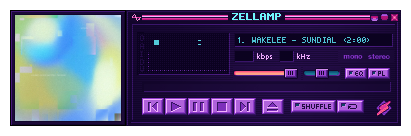
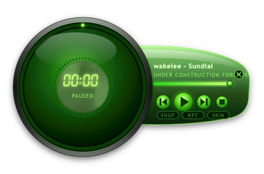
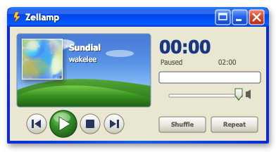
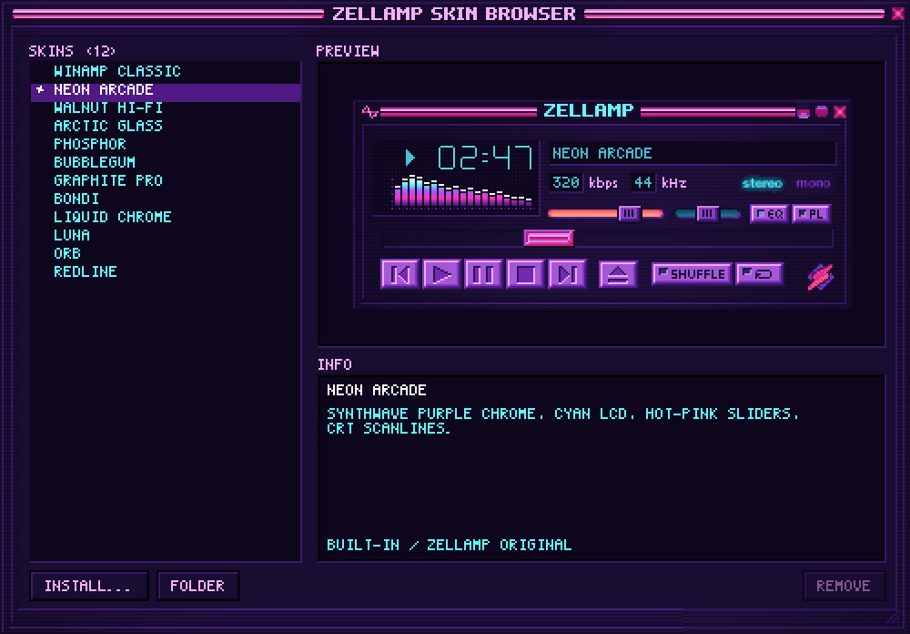

# Zellamp

<p>
  
  
  
</p>

**A Winamp 2 skin for whatever you're already listening to.** Zellamp is a small, always-on-top desktop player that remote-controls the Spotify app (macOS and Windows) or a browser player like YouTube Music (Windows). It shows the track, album art and a live spectrum, in classic Winamp `.wsz` skins or freeform skins of any shape.

Full disclosure: the hardest part isn't mine. The player is [Webamp](https://github.com/captbaritone/webamp), Jordan Eldredge's faithful Winamp 2 rebuild for the web. Zellamp is the desktop app around it: it drives Webamp from your real player instead of local files, and adds its own skins, the freeform skin format, the Skin Browser, album art, zoom and the visualizer's audio capture.

```
Spotify / browser player  ⇄  Zellamp (main process)  →  Webamp or a freeform skin  →  your desktop
                              AppleScript (macOS)
                              system media controls (Windows)
```

## Download

Grab the installer from [**Releases**](../../releases/latest).

- **macOS:** open the DMG and drag **Zellamp** to Applications. Requires macOS 13 or later on Apple Silicon. The app isn't notarized yet, so the first launch is blocked: open **System Settings › Privacy & Security** and click **Open Anyway**.
- **Windows 10/11 (x64):** run **Zellamp-Setup.exe**. SmartScreen warns about an unknown publisher: click **More info › Run anyway**.

On first launch the **Setup Assistant** walks you through what your system needs (on macOS: permission to control Spotify, and optionally to hear audio for the visualizer).

## Using the app

### The player

- Play, pause, skip, seek and volume go straight to your player. Zellamp never plays audio itself.
- Drag the player anywhere, across displays too. It snaps to screen edges and remembers its spot per skin.
- **Right-click** the player (any skin) for the menu: Playback, Playlist Editor, Skins, Zoom, Show Album Art, Options, Hide and Exit.
- **Zoom** scales the pixel art to 100%, 150%, 200% or 300% without blurring it.
- **Album art** docks beside the classic player, or appears inside freeform skins that have a spot for it.
- Closing the player hides it. Bring it back from the menu bar icon (macOS) or the tray icon (Windows).

### Skins



**Right-click › Skins › Skin Browser…** (⌘T on macOS) lists every installed skin with a live preview. Click one to apply it.

- **Classic skins:** any Winamp 2 `.wsz`. Drop one on the Skin Browser or use **Install…**. Thousands live at the [Winamp Skin Museum](https://skins.webamp.org).
- **Freeform skins:** a single SVG of any shape. Transparent areas click through to the desktop. See [docs/freeform-skins.md](docs/freeform-skins.md) to make your own.
- Zellamp's own windows (Skin Browser, Setup, About) re-skin themselves from the active skin.

Built in: Winamp Classic, Neon Arcade, Walnut Hi-Fi, Arctic Glass, Phosphor, Bubblegum and Graphite Pro (classic), plus Orb, Luna, Liquid Chrome, Redline and Bondi (freeform).

### What it follows

| | macOS | Windows |
| --- | --- | --- |
| Spotify app | ✓ (AppleScript) | ✓ (system media controls) |
| Browser players (YouTube Music, SoundCloud, …) | — | ✓ whatever appears in Windows' media flyout |
| Visualizer | your Mac's audio output (needs Screen & System Audio Recording) | your PC's audio output (no setup) |

On Windows, Spotify wins when it's open; otherwise Zellamp follows the current media session.

## Limitations

- **The visualizer hears everything** your computer plays, notifications included, not just the music.
- **No equalizer.** Zellamp can't shape another app's audio, so the EQ window is hidden.
- **No queue.** Spotify's scripting only exposes the current track; the queue needs Spotify's Web API, which only allows a small hand-picked set of users per app. The playlist window shows the current track only.
- **Browser players on Windows** can drift a second or so between the browser's updates: browsers report the position less often than Spotify does.
- **No browser players on macOS** yet. That needs a browser extension.
- macOS builds are Apple Silicon only, and aren't notarized (see Download).

## Building from source

See [DEVELOPMENT.md](DEVELOPMENT.md): setup, project layout, dev hooks and debug tooling, tests, releasing, and notes on how each part works.

## Credits

- [Webamp](https://github.com/captbaritone/webamp) by Jordan Eldredge: the Winamp 2 player itself (MIT)
- [Electron](https://www.electronjs.org): the desktop shell (MIT)
- The Winamp 2 base skin by Nullsoft, which the classic skin and Zellamp's generated skins derive from
- Every skin author whose `.wsz` you install: the skins are theirs

Zellamp is MIT licensed (see [LICENSE](LICENSE)) and not affiliated with Winamp or Spotify. Third-party notices are in [THIRD_PARTY_NOTICES.txt](THIRD_PARTY_NOTICES.txt).
